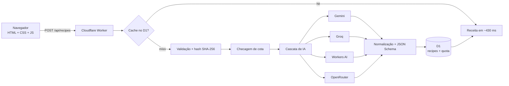

# Saborê 🍅

**Do que tem na dispensa para uma receita completa — com IA, na borda e a custo zero.**

[](https://sabore.filipefolletto.workers.dev)
[](https://workers.cloudflare.com/)
[](https://developers.cloudflare.com/d1/)
[](https://developer.mozilla.org/docs/Web/JavaScript)


---

## Em 30 segundos

O **Saborê** transforma um pedido simples — “frango com creme de abóbora”,
“panqueca de banana” — em uma receita completa: ingredientes com medida, modo
de preparo em passos, dicas de cozinha e estimativas nutricionais.

O diferencial não é só a IA. É a **engenharia em volta dela**:

- **100% free tier** — Cloudflare Workers + D1 + provedores gratuitos de IA, sem cartão.
- **Zero build** — HTML, CSS e JavaScript puros no front; sem npm, bundler ou framework.
- **Cache-first** — a mesma busca volta do D1 em ~430 ms e não gasta token.
- **Resiliente** — cascata de 4 provedores, com timeout e fallback automático.
- **Seguro** — chaves só nos segredos do Worker; o navegador nunca vê.
- **Acessível** — WCAG AA nos dois temas, dark mode e `prefers-reduced-motion`.

> **Demo:** [sabore.filipefolletto.workers.dev](https://sabore.filipefolletto.workers.dev)

---

## O que este projeto demonstra

| Competência | Como aparece no projeto |
| --- | --- |
| **Arquitetura serverless** | Worker na borda serve API e assets; D1 como cache e quota; nenhum servidor para manter. |
| **Integração com IA** | Quatro provedores, JSON Schema/structured output, normalização defensiva e fallback. |
| **Backend** | REST, validação de entrada, SHA-256, cache, cota por IP, CORS e erros claros. |
| **Front-end** | HTML semântico, CSS com tokens, dark mode, responsivo e JS puro com localStorage. |
| **Produto** | Fluxo completo: formulário, loading, resultado, favoritos, porções, cota e compartilhamento. |
| **Design system** | Paleta, tipografia, contraste e componentes documentados; nenhum hex solto. |
| **Custo como requisito** | Cada decisão foi tomada para caber no plano gratuito. |
| **Resiliência** | Timeouts, fallback entre provedores e mensagens de erro úteis. |

---

## Arquitetura



### O caminho de uma requisição

1. O front envia `POST /api/recipes` com prato, restrições, porções e tempo.
2. O Worker valida e normaliza a entrada.
3. O pedido vira um hash SHA-256 canônico.
4. **Cache hit:** o D1 devolve a receita em milissegundos, sem gastar token nem cota.
5. **Cache miss:** o Worker checa a cota do IP no dia (UTC).
6. A cascata tenta **Gemini → Groq → Workers AI → OpenRouter**, com timeout por provedor.
7. A resposta é normalizada e ajustada ao contrato do front.
8. A receita é gravada no D1 e a cota é incrementada.
9. O front renderiza ingredientes, passos, dicas e nutrição.

---

## Decisões de engenharia

| Decisão | Por quê | Trade-off |
| --- | --- | --- |
| **Cache por hash canônico** | A mesma busca devolve o mesmo JSON; economiza tokens e latência. | Cache de 30 dias; mudanças de prompt exigem invalidação. |
| **Cota por IP/dia** | Protege a chave gratuita sem exigir login. | NAT compartilhado pode dividir a cota entre usuários. |
| **Cascata de provedores** | Disponibilidade quando um modelo gratuito cai. | O fallback pode aumentar a latência. |
| **JSON Schema + normalização** | Saída previsível mesmo com modelos diferentes. | Prompt maior e ajustes por provedor. |
| **Sem build no front** | Deploy direto, menos dependências, mais controle. | Sem TypeScript/bundler; disciplina manual. |
| **Design tokens** | Consistência e acessibilidade em dois temas. | Requer disciplina para não soltar hex. |
| **Free tier como requisito** | O projeto precisa rodar sem cartão. | Menos throughput e modelos mais lentos. |

---

## Stack

| Camada | Tecnologias |
| --- | --- |
| **Front-end** | HTML5, CSS3 (custom properties, grid/flex, dark mode), JavaScript puro, Fetch API, localStorage |
| **Backend** | Cloudflare Workers (ES modules), REST, Web Crypto (SHA-256), CORS |
| **Dados** | Cloudflare D1 (SQLite): `recipes` e `quota` |
| **IA** | Gemini REST, Groq, OpenRouter, Workers AI |
| **Infra** | Cloudflare Workers Assets, Wrangler, Git |
| **Qualidade** | Design tokens, WCAG AA, `prefers-reduced-motion`, validação de schema |

---

## Resultados

| Métrica | Valor |
| --- | --- |
| Cache hit | ~430 ms |
| Geração via provedor gratuito | ~19–31 s |
| Provedores na cascata | 4 |
| Cota padrão | 20 receitas/dia por IP |
| TTL do cache | 30 dias |
| Custo de infraestrutura | $0 |

> A latência de geração é o trade-off consciente do custo zero. O cache resolve
> o caso repetido — e é ele que segura a experiência no dia a dia.

---

## API

### `POST /api/recipes`

```json
{
  "dish": "frango com creme de abóbora",
  "diet": ["sem lactose"],
  "difficulty": "Fácil",
  "servings": 4,
  "maxMinutes": 45,
  "equipment": "Fogão",
  "notes": "sem glúten"
}
```

Resposta `200`:

```json
{
  "recipe": {
    "title": "Frango com Creme de Abóbora",
    "description": "Frango dourado com um creme sedoso de abóbora.",
    "emoji": "🍲",
    "servings": 4,
    "prepMinutes": 10,
    "cookMinutes": 30,
    "totalMinutes": 40,
    "difficulty": "Fácil",
    "cuisine": "Brasileira",
    "nutrition": {
      "calories": 420,
      "proteinGrams": 32,
      "carbsGrams": 24,
      "fatGrams": 18
    },
    "ingredients": [
      { "quantity": "500 g", "name": "frango", "note": "em cubos" }
    ],
    "steps": [
      {
        "title": "Doure o frango",
        "durationMinutes": 8,
        "description": "Tempere e doure em fogo alto."
      }
    ],
    "tips": ["..."],
    "tags": ["frango", "abóbora"]
  },
  "provider": "gemini",
  "model": "gemini-3.8-flash",
  "cache": "miss",
  "quota": { "used": 1, "limit": 20, "remaining": 19 }
}
```

### `GET /api/health`

```json
{
  "ok": true,
  "service": "sabore",
  "model": "gemini-3.8-flash",
  "providers": ["gemini", "groq", "workers-ai", "openrouter"],
  "database": true,
  "quota": { "used": 1, "limit": 20, "remaining": 19 },
  "limits": { "maxMinutes": 180, "maxServings": 12, "cacheTtlDays": 30 }
}
```

### Códigos de status

| Código | Quando |
| --- | --- |
| `200` | Receita gerada ou cache hit |
| `400` | Entrada inválida |
| `429` | Cota diária esgotada |
| `502` | Nenhum provedor respondeu |

### Cache

O pedido normalizado vira um hash SHA-256. A mesma busca (incluindo porções,
dificuldade e tempo) devolve o JSON guardado no D1 em milissegundos e **não
gasta token nem cota**.

### Cota

`MAX_RECIPES_PER_DAY` (padrão **20**) gerações reais por IP por dia, em UTC.
Cache não conta. Ao esgotar, a API responde `429` com uma mensagem clara.

### Cascata de provedores

1. **Gemini** (`gemini-3.8-flash`) — JSON Schema via `responseJsonSchema`; se o
   endpoint recusar, tenta `responseSchema` e depois só `responseMimeType`
   (JSON sem schema).
2. **Groq** (`openai/gpt-oss-120b`) — `response_format: json_schema`.
3. **Workers AI** (`@cf/google/gemma-4-26b-a4b-it`) — binding `AI`, sem chave,
   com `json_schema` nativo; fallback para Qwen3 30B e Llama 3.3 70B.
4. **OpenRouter** (modelos `:free`) — lista de modelos com fallback em
   429/404/5xx/timeout.

Cada provedor tem timeout: **15 s** no Gemini/OpenRouter, **30 s** no Groq e
**30–35 s** no Workers AI. Se estourar, o Worker aborta e tenta o próximo.

---

## Rodar localmente

### Só a interface

Abra `index.html` no navegador. O formulário, os favoritos, o tema e o
redimensionamento de porções funcionam. A geração precisa da API.

### Com a API

Precisa de Node.js LTS e Wrangler.

```bash
wrangler login

# schema no D1 local
wrangler d1 execute Auto-receitas --local --file=./worker/schema.sql

# crie .dev.vars (fora do git) com as chaves:
# GEMINI_API_KEY=sua-chave
# GROQ_API_KEY=sua-chave
# OPENROUTER_API_KEY=sua-chave

wrangler dev
```

O app fica em `http://localhost:8787`. Para abrir o `index.html` direto do
disco apontando para o servidor local:

```text
index.html?api=http://localhost:8787/api
```

> No Windows, se o PowerShell bloquear `wrangler`, use `wrangler.cmd`.

---

## Deploy

### 1. Banco D1

```bash
wrangler d1 execute Auto-receitas --remote --file=./worker/schema.sql
```

Para recriar do zero: `wrangler d1 create Auto-receitas`, copie o
`database_id` para `wrangler.toml` e rode o comando acima.

### 2. Segredos

```bash
wrangler secret put GEMINI_API_KEY       # principal (recomendado)
wrangler secret put GROQ_API_KEY         # opcional (reserva)
wrangler secret put OPENROUTER_API_KEY   # opcional (reserva)
```

> Sem nenhuma chave, o binding `AI` (Workers AI) ainda pode gerar receitas. As
> chaves só ampliam a qualidade e a velocidade da cascata.

### 3. Publicar

```bash
wrangler deploy
```

O `wrangler` publica `index.html`, `assets/` e o Worker juntos. Confira com
`GET /api/health`.

> O D1 é essencial para cache e cota. Sem ele o site abre, mas roda sem cache e
> sem cota — ou seja, qualquer um pode queimar a cota gratuita do provedor de IA.

---

## Chaves e custo

| Segredo | Onde nasce | Papel | Custo |
| --- | --- | --- | --- |
| `GEMINI_API_KEY` | [aistudio.google.com/apikey](https://aistudio.google.com/apikey) | principal recomendado (`gemini-3.8-flash`) | $0 no free tier |
| `GROQ_API_KEY` | [console.groq.com/keys](https://console.groq.com/keys) | reserva #1 (`openai/gpt-oss-120b`) | $0 |
| `OPENROUTER_API_KEY` | [openrouter.ai/keys](https://openrouter.ai/keys) | reserva #2 (modelos `:free`) | $0 |
| binding `AI` | `wrangler.toml` | reserva Workers AI (sem chave) | 10.000 Neurons/dia |

As chaves vivem **só** nos segredos do Worker. O navegador nunca vê.

---

## Design system

Tudo vive em `assets/guide.css`. A regra do projeto é simples: **nenhum hex
solto no CSS** — se faltar um valor, ele nasce como token primeiro.

| Papel | Token | Claro | Escuro |
| --- | --- | --- | --- |
| Primária | `--primary` | `--green-500` `#28594C` | `--green-300` `#82C4B3` |
| Secundária | `--secondary` | `--coral-700` `#BA3517` | `--coral-300` `#EB9784` |
| Acento | `--accent` | `--gold-500` `#F6C453` | `--gold-300` `#F4D48B` |
| Fundo | `--bg` | `--cream` `#F7F3E8` | `#141A18` |
| Superfície | `--surface` | `--sand-0` `#FFFDF8` | `#1A221F` |
| Texto | `--text` | `--ink` `#1F2824` | `#F1EEE7` |

**Tipografia:** Fraunces (display, 700) + Manrope (interface, 400/600/700).

**Acessibilidade:** os pares de texto/fundo usados no app passam em **4,5:1**
(WCAG AA) nos dois temas; o loading respeita `prefers-reduced-motion`.

---

## Estrutura do projeto

```text
index.html                  app (gerador de receitas)
assets/guide.css            tokens, reset, tipografia e componentes
assets/app.css              estilos específicos do app
assets/app.js               lógica do app
assets/favicon.svg          ícone da marca
assets/og.png               card de compartilhamento (1200×630)
assets/loading-tomate.gif   loading do card de resultado
worker/index.js             API: cache, cota e cascata de IA
worker/schema.sql           schema do D1
wrangler.toml               configuração do Worker
.assetsignore               o que não vai para o estático público
```

---

## Qualidade

- **Design system verificável:** tokens referenciados existem, sem tokens
  órfãos e sem hex solto fora dos tokens.
- **HTML consistente:** IDs únicos, âncoras internas válidas e ícones do sprite
  usados.
- **Acessibilidade:** contraste WCAG AA nos dois temas, foco visível, rótulos
  acessíveis e fallback de loading sem movimento.
- **Backend defensivo:** validação de entrada, normalização da resposta da IA,
  erros claros e timeout por provedor.
- **Observabilidade:** `GET /api/health` mostra provedores, banco e cota.

---

## Limites honestos

- **Custo zero tem trade-off:** modelos gratuitos podem oscilar e a geração
  leva ~19–31 s; o cache resolve a repetição (~430 ms).
- **Gemini no free tier** usa conteúdo para melhorar produtos do Google. Se
  isso for um problema, use Groq/OpenRouter ou um plano pago.
- **OpenRouter sem créditos** limita modelos `:free` (~20 req/min e ~50 req/dia).
- **Workers AI Free** tem 10.000 Neurons/dia.
- **Valores nutricionais** são estimativas geradas por IA, não dados clínicos.

---

## Próximos passos

- [ ] Streaming da resposta (SSE) para reduzir a percepção de espera.
- [ ] Testes automatizados (unitários + integração) e CI.
- [ ] Métricas por provedor: latência, taxa de fallback e custo estimado.
- [ ] Rate limit distribuído / Turnstile contra abuso.
- [ ] PWA com cache offline das receitas favoritas.
- [ ] Histórico por usuário (login opcional) e compartilhamento.

---

## Autor

Feito por **Filipe Folletto** — [GitHub](https://github.com/filipefolletto).

Se você é recrutador(a) e quer conversar sobre o projeto, me chama no GitHub.
